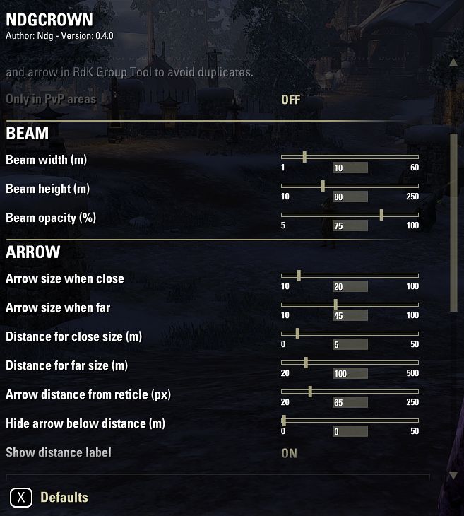
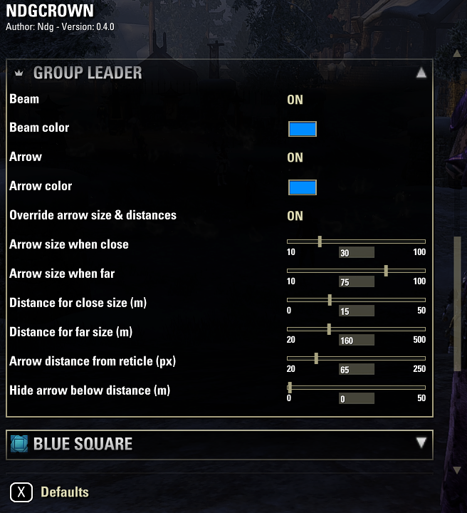
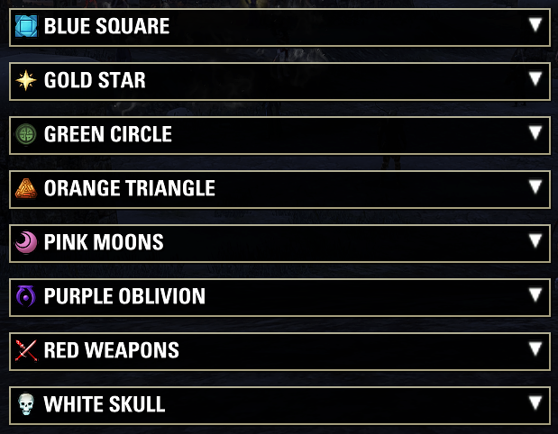

# NdgCrown

An Elder Scrolls Online addon that shows a tall 3D beam, a direction arrow next to your reticle and/or a range ring on the ground for the **group leader** ("the crown") and for units carrying **base-game target marks** — find your raid lead at a glance.

## Screenshot

The settings panel: the group leader and each of the eight base-game target marks get their own beam/arrow toggles and colors, plus an optional per-target override of the arrow size/distance settings.

## Features

- **Group leader**: a colored beam at the leader's position plus an arrow orbiting your reticle that points toward them (enabled by default, blue). Uses live group positions, so it is always accurate. Inactive while you are the leader yourself. When arrows overlap, the crown arrow always draws on top of the mark arrows.
- **Target marks**: the same beam and arrow for units carrying any of the eight base-game target markers (Blue Square, Gold Star, Green Circle, Orange Triangle, Pink Moons, Purple Oblivion, Red Weapons, White Skull). Each mark has its own toggles and colors — defaults match the marker's color, all marks are disabled by default.
- The arrow scales with distance, can show a distance label, and can hide when the target is closer than a configurable distance. Every target can optionally **override the global arrow size/distance settings** with its own values.
- **Range rings**: a ring on the ground around the leader or any mark with a configurable radius (e.g. 8m, to see whether you are in range of the leader's heals and shields). It turns green while you are inside (3D distance) and red outside — both colors configurable. Optionally also a ring around yourself.
- Optional **PvP only** mode: only active in Cyrodiil, Imperial City and Battlegrounds.

## How tracking works (and its limits)

The game restricts what addons can know about unit positions. NdgCrown only ever draws from a real, known position — there are two sources:

1. **Group members**: live, continuous positions anywhere in the zone — beam and arrow are always exact.
2. **NPCs under your crosshair**: positions are read while your reticle is on the marked NPC (works at close range only).

Players outside your group cannot be tracked — the game hides their positions from addons completely.

When a position stops updating, the **arrow disappears immediately** (an arrow pointing at a stale spot would be misleading), while the **beam keeps marking the last known position for 10 more seconds** — it marks a fixed spot in the world, so it stays useful as "last seen here" — fading out toward the end. A mark that is removed from a group member disappears right away instead of lingering.

## Settings

Open the settings panel via **ESC > Settings > Addons > NdgCrown**. General options cover beam size, opacity and visibility through terrain, range-ring opacity and the ring around yourself, arrow sizing and behavior over distance, and the distance label; below that, every tracked target has its own submenu (beam on/off + color, arrow on/off + color, range ring on/off + radius + in-range/out-of-range colors, and an "Override arrow size & distances" checkbox that unlocks per-target copies of the arrow sliders).

If you enable the leader beam/arrow here, disable the "Follow the Crown" beam and arrow in RdK Group Tool to avoid duplicates.

## Slash commands

| Command | Effect |
|---------|--------|
| `/ndgcrown` | Print a status overview: update loop and tracked targets (distance, position age, live/lingering) |
| `/ndgcrown probe` | Toggle a diagnostic probe that logs what the position APIs return for the unit under the crosshair (also to LibDebugLogger) |
| `/ndgcrown beamprobe` | Toggle a diagnostic probe that logs once per second where the leader beam is placed and why (to LibDebugLogger) |

## Installation

1. Copy the files into a `NdgCrown` folder inside your `Elder Scrolls Online/live/AddOns/` directory
2. Ensure the required library is installed (see below)
3. Enable the addon in the ESO addon manager

## Dependencies

| Library | Version | Purpose |
|---------|---------|---------|
| [LibAddonMenu-2.0](https://www.esoui.com/downloads/info7-LibAddonMenu.html) | >= 30 | Settings panel UI |
| [LibDebugLogger](https://www.esoui.com/downloads/info2275-LibDebugLogger.html) | optional | Debug logging for the probe and troubleshooting |

## License

This addon is provided as-is for personal use with The Elder Scrolls Online.
